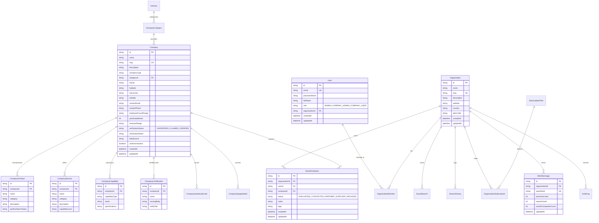

# Database Design & Entity-Relationship Model — VIASET

## 1. Overview
The VIASET database schema is designed as a normalized, highly performant relational model using Prisma ORM. It currently targets SQLite for lightweight zero-dependency local development, with explicit column types, indexes, and foreign key cascades to ensure seamless future migration to PostgreSQL.

---

## 2. Entity-Relationship Diagram

---

## 3. Entity Definitions & Integrity Rules

### 3.1 Organization & User Multi-Tenancy
- `User`: Primary identity table. Enforces unique email and hashed credentials.
- `Organization`: Logical boundary for enterprise billing, saved company portfolios, and team members.
- `OrganizationMember`: Manages team permissions within the company.

### 3.2 Company Intelligence & Technical Capabilities
- `Company`: Core entity containing corporate profiles, headquarters, verified contact details, verification status, and data source citations.
- `CompanyCapability`: High-precision technical specs (e.g., "Process Node: 28nm", "SMT Placement: 01005 chips", "Cleanroom: ISO Class 6", "Wafer Size: 300mm").
- `CompanyProduct`: Catalog items (e.g., "RISC-V Microcontrollers", "Multilayer Ceramic Capacitors", "Power Management ICs").
- `CompanyService`: Technical services (e.g., "Turnkey PCBA", "ASIC Design Verification", "Automotive EMC Testing").
- `CompanyCertification`: Quality standards (e.g., "IATF 16949", "ISO 9001", "AS9100D", "RoHS Compliant").

### 3.3 Discovery, Saved Companies & Pipelines
- `SavedCompany`: Maps a company into an organization's supplier/partner discovery pipeline with custom private notes and lifecycle stages (`EVALUATING`, `CONTACTED`, `PARTNER`, `SUPPLIER`, `ARCHIVED`).
- `SavedSearch`: Stores complex query parameters for rapid 1-click re-execution.
- `SearchHistory`: Records user search trends to power organization discovery analytics.

### 3.4 Subscriptions & Usage Quotas
- `SubscriptionPlan`: Seeded definitions for `BASIC`, `PRO`, and `ENTERPRISE` tiers.
- `MonthlyUsage`: Per-month counters tracking API searches, CSV/Excel exports, and saved companies.
